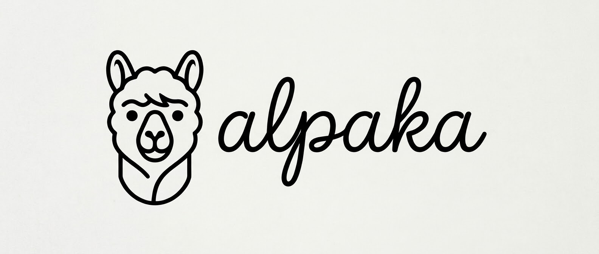

  

## 👥 Equipo / Integrantes

Somos 3 desarrolladores unidos:

  <table>
    <tr>
      <td align="center" width="33%">
        <a href="https://github.com/personalusevictor">
           
          <b>Víctor</b>
        </a>
      </td>
      <td align="center" width="33%">
        <a href="https://github.com/suerooo">
           
          <b>Raúl</b>
        </a>
      </td>
      <td align="center" width="33%">
        <a href="https://github.com/alelhdev">
           
          <b>Alejandro</b>
        </a>
      </td>
    </tr>
  </table>

## 📁 Explorador de Repositorios

Explora nuestros proyectos y repositorios directamente desde aquí:

  <table>
    <tr>
      <td width="50%" valign="top">
        <h3><code>/dpto-inf</code></h3>
        
<b>Página web - Departamento Informática | IESJMPP</b>

        
Sistema completo construido para gestión en tiempo real con dashboard analítico.

        

          <code>React</code> • <code>JavaScript</code> • <code>PHP</code>
        

        <a href="https://github.com/alpaka-dev/dpto-inf"><b>Ver Repositorio</b></a>
      </td>
    </tr>
  </table>

## 🛠️ Tecnologías que utilizamos

  
  
  
  
  
  
  

## 📫 Contacto & Redes

¡Nos encantaría colaborar en nuevos proyectos o escuchar tus propuestas!

 

  © 2026 - Alpaka

